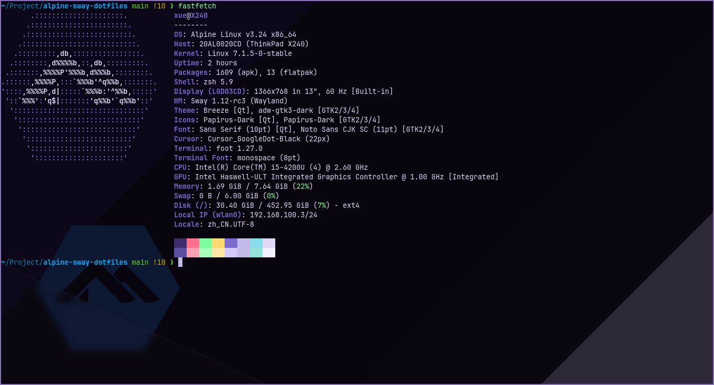
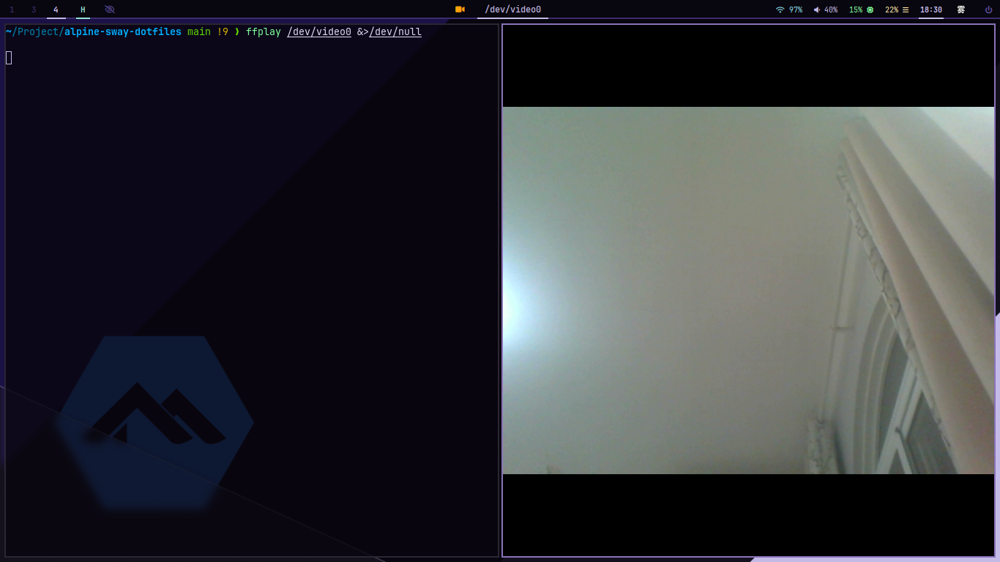

# Alpine-Sway-Dotfiles

Sway window manager dotfiles for Alpine Linux — kept simple and readable, with a few helpers for getting Alpine set up.

## Introduction

This is a minimal, tweakable Sway setup for Alpine Linux. It favors clarity over cleverness, so you can read each config and adjust it to fit your own workflow. All shell scripts are POSIX `sh` (no bash required), and it's written for Alpine but portable — fork it and adapt it to any other distro.

> There's intentionally no `setup.sh`. Automating the copy would risk clobbering configs you already have. Instead, back up your existing configs and copy the ones here over yourself.
> Some configs/comments are in Chinese (qutebrowser, waybar scripts). You may want to rewrite them for your own locale.

### Screenshots

Normal mode with a foot terminal:



Privacy indicator (mic muted / camera / location / screen sharing / recording):



## What's included

- **Sway** with 10 workspaces, Vim-style focus keys, gestures, scratchpad, screenshot/recording bindings.
- **Waybar** with workspace/layout indicator (H/V/T/S), privacy indicator (mic mute, camera, location, screen sharing, recording red dot), volume/network/cpu/memory/clock/battery/tray/power, and a system-info panel on `$mod+i`.
- **Power menu** on `$mod+x` or by clicking the power element; the waybar-triggered one is anchored under the button and closes on focus loss.
- **Automation**: media is paused before lock/suspend; waybar is restarted after suspend; audio services are restarted from a clean state on login.
- **Launcher**: fuzzel (app menu, clipboard menu, power menu).
- **Apps**: foot, fuzzel, fnott, qutebrowser, Helix, cliphist, fcitx5 configs.

## Config layout

The main `config` is deliberately tiny: it only loads fragments, starts the session, and exports variables. Everything else is split by responsibility, so you can find and tweak one thing without reading the whole setup:

```text
~/.config/sway/
├── config                 # entry point: includes, startup.sh, D-Bus env
└── config.d/
    ├── binds.sway         # keys, gestures, resize mode (bindsym/bindgesture)
    ├── idle.sway          # swayidle, suspend, idle inhibition
    ├── input.sway         # keyboard / touchpad settings
    ├── rules.sway         # per-window rules (currently Firefox PiP)
    └── theme.sway         # borders, gaps, wallpaper, cursor
```

Reusable commands live in `scripts/` instead of being inlined into keybindings: `startup.sh`, `screenshot.sh`, `record.sh`, `sysinfo.sh`, `restart_waybar.sh`, `fuzzel-drun.sh`. That keeps `binds.sway` to a readable "key -> script" mapping.

> File extension: Sway's `include config.d/*` does not care about suffixes. `.sway` is just a convention used here; it is not required by Sway.

## Requirements

All shell scripts use POSIX `sh` (busybox ash is enough); `bash` is **not** required.

### System

Needed for the session, D-Bus, permissions and suspend:

- `dbus` (`dbus-daemon`, `dbus-send`, `dbus-update-activation-environment`)
- `dbus-x11` (`dbus-launch`)
- `seatd` (`seatd-launch`)
- `doas` or `sudo`
- `elogind` (`loginctl`, suspend/lock)
- `polkit-elogind`
- `udisks2`
- `greetd` + `greetd-tuigreet` (login manager and its TUI greeter)

```sh
doas apk add dbus dbus-x11 seatd doas elogind polkit-elogind udisks2 greetd greetd-tuigreet
```

### Audio

Pipewire stack plus the tools used by scripts/waybar (`pw-dump`, `wpctl`, `pactl`, `amixer`):

- `alsa-utils`, `pipewire`, `pipewire-alsa`, `pipewire-pulse`, `pipewire-tools`
- `pulseaudio-utils`, `wireplumber`, `wireplumber-logind`
- `wayland-pipewire-idle-inhibit`

```sh
doas apk add alsa-utils pipewire pipewire-alsa pipewire-pulse pipewire-tools pulseaudio-utils wireplumber wireplumber-logind wayland-pipewire-idle-inhibit
```

Optional GUI mixer:

```sh
doas apk add pavucontrol pavucontrol-lang
```

### Desktop

Core WM/bar/launcher, screenshot & recording, and helper tools used by the scripts:

- `sway`, `swaybg`, `swayidle`, `swaylock-effects` (provides `swaylock`), `waybar`, `xwayland`
- `wl-clipboard`, `cliphist`, `fnott`, `fuzzel`
- `grimshot`, `wf-recorder`, `slurp` (screenshots/recording)
- `jq` (JSON parsing in waybar scripts), `playerctl` (media keys / pause on lock)
- `fcitx5` (input method)
- `xdg-desktop-portal`, `xdg-desktop-portal-wlr` (screen sharing)

```sh
doas apk add sway swaybg swayidle swaylock-effects waybar xwayland wl-clipboard cliphist fnott fuzzel grimshot wf-recorder slurp jq playerctl fcitx5 xdg-desktop-portal xdg-desktop-portal-wlr
```

### Font

```sh
doas apk add font-noto font-noto-cjk font-noto-emoji font-noto-music font-jetbrains-mono-nerd
```

### Recommended / optional apps

These have configs in the repo but aren't required for the desktop itself:

```sh
doas apk add eza fortune helix qutebrowser
```

## Installation

First, I recommend running `su -c 'setup-desktop sway'`, which installs some base packages automatically.

Then install the packages above and copy the configs. Make sure you're in the repo root:

```sh
# Core desktop configs
mkdir -p ~/.config
for d in sway swaylock waybar fuzzel fnott foot fontconfig; do cp -r "./user-home/.config/$d" ~/.config/; done

# Optional app configs
for d in helix qutebrowser; do cp -r "./user-home/.config/$d" ~/.config/; done

# Shell / editor dotfiles
for f in profile zshrc p10k.zsh fzf.zsh vimrc; do cp "./user-home/.$f" ~/; done
mkdir -p ~/.vim && cp -r ./user-home/.vim/. ~/.vim/

# Themes, cursor and wallpapers
mkdir -p ~/.local/share
for d in fcitx5 icons; do cp -r "./user-home/.local/share/$d" ~/.local/share/; done
cp -r ./user-home/Pictures ~/Pictures

# Make sure the scripts stay executable
chmod +x ~/.config/sway/scripts/*.sh ~/.config/waybar/scripts/*.sh ~/.config/qutebrowser/userscripts/save_links
```

Note: qutebrowser's generated files (`autoconfig.yml`, `links.js`, `quickmarks.js`, `qsettings/`) are intentionally ignored and not part of the repo.

Display manager: this repo uses **greetd + tuigreet** only (lightdm is not included). To install its configured greeter:

```sh
doas cp ./etc/greetd/config.toml /etc/greetd/config.toml
```

The greeter defaults to `sway`, offers a session menu (F3), command menu (F2), power menu (F12), remembers the last username, and uses a compact purple theme.

Finally, reload sway (`$mod+Shift+c`) or log out and back in. Check the config with:

```sh
sway -C -c ~/.config/sway/config
```
